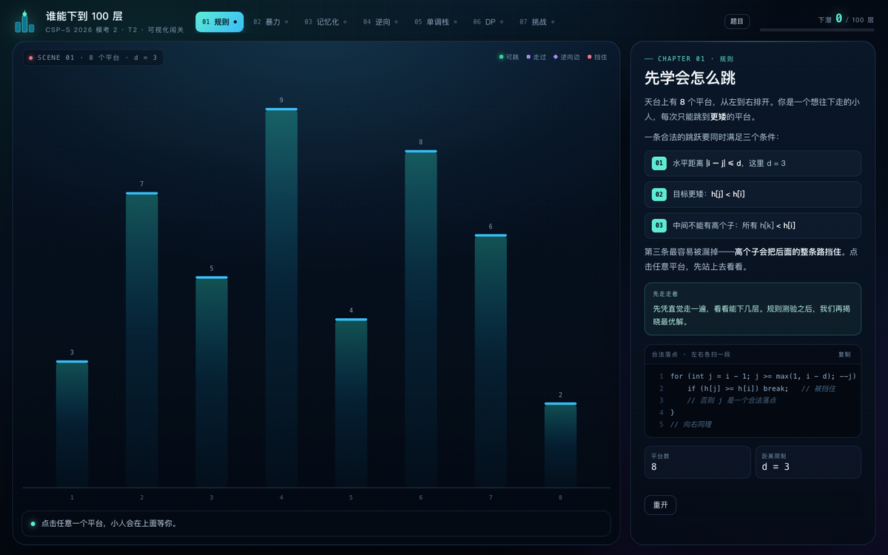

# 模考 2 · T2《谁能下到 100 层》可视化闯关

打开 `T2_谁能下到100层_可视化闯关.html`（双击，或拖进浏览器）即可开始。
**单文件、零依赖、离线可用**，不需要启动服务器。



## 这是什么

一座可以点的天台塔。你先凭直觉往下跳，页面再把这道题从 16 分暴力一路讲到 100 分正解：

| 章节 | 你会做什么 | 对应做法 |
| --- | --- | --- |
| 01 规则 | 点平台起跳、点绿点下落，回答“6 号能不能跳到 3 号” | 理解三条跳跃条件 |
| 02 暴力 | 运行无记忆化 DFS，看 10 个平台被调用 **1,023** 次 | 16 分 |
| 03 记忆化 | 同一座塔只展开 10 个状态，徽章逐个点亮 | 48 分，O(nd) |
| 04 逆向 | 点任意平台，看它的两条“上一跳”边；切换 d 看距离截断 | 关键转化 |
| 05 单调栈 | 单步/自动播放栈的弹出与压入，同时画出 L/R 边 | O(n) 求最近更高 |
| 06 DP | 按高度倒序填 dp 表，再还原整条下坡路线 | O(n log n)，可优化到 O(n) |
| 07 挑战 | 随机 16 层塔，自己跳 vs 算法演示 | 综合实战 |

每章完成会累积“下潜层数”，七章合计 **100 层**，全部完成会触发通关动画。

## 核心结论

把“向下跳”的边全部反过来，就变成“从矮平台跳向能接住它的更高平台”。
每个点只需要连两条边：

- `L[i]`：左边最近的、严格高于 `h[i]` 的平台（且距离 ≤ d）
- `R[i]`：右边最近的、严格高于 `h[i]` 的平台（且距离 ≤ d）

`dp[i] = 1 + max(dp[L[i]], dp[R[i]])`，按高度从高到低填表，答案取最大值。
左右各扫一遍单调递减栈，求 L/R 是 O(n)。

为什么更远的更高平台不用连？如果 p 能跳过中间的 q 落到 i，说明 q 比 p 矮；
那不如先在 q 停一脚，合法且多踩一层。所以“最近更高”永远不劣。

严格地说：q 在 p、i 之间，所以 `h[q] < h[p]`，`p→q` 合法；q 又是 i 左边最近的更高平台，
所以 q、i 之间都 ≤ `h[i] < h[q]`，`q→i` 也合法；距离限制对子区间同样成立。

## 复杂度说明

页面为了演示清晰，`solveReverse` 在 DP 前按高度执行了一次 `sort`，所以**页面实现是 `O(n log n)`**：

```text
单调栈 O(n) + 排序 O(n log n) + DP O(n) = O(n log n)
```

这不是错误做法，n = 2×10^5 时完全够用。若想严格 `O(n)`，可改用记忆化 DFS 或拓扑排序；
但高度可能形成长链，递归写法要注意爆栈，工程上更稳的是显式栈或拓扑 DP。页面与本文档不再把该实现称为“纯 O(n)”。

## 正确性验证

- 100 分标程与 O(nd) 暴力随机对拍 **800 组**，全部一致（含等高、d=1、d=n 等情况）。
- 逆向单调栈 DP 与暴力记忆化对拍 **200,000 组**，全部一致。
- 页面内所有演示数据（各章答案、调用次数、dp 值）均由页面实时计算，不是写死的结论。

## 文件说明

- `T2_谁能下到100层_可视化闯关.html`：完整页面（HTML + CSS + JS，约 90 KB）。
- 题面、标程与题解 PDF 位于 `../CSP-S 复赛模考 2 标程 & 题解/`。
- 本页复杂度与“调用/状态”表述的说明见 [`../CSP-S 复赛模考 2 标程 & 题解/勘误.md`](../CSP-S%20复赛模考%202%20标程%20%26%20题解/勘误.md)。
